<p align="center">
  <picture>
    <source media="(prefers-color-scheme: dark)" srcset=".github/assets/lockup-dark.svg">
    
  </picture>
</p>

<p align="center">
  <b>Change safety for agents.</b><br>
  Record, replay and fork AI agent runs: reproduce a failure exactly,<br>
  find the call that lost the run, and prove&nbsp;your&nbsp;fix holds before it ships.
</p>

<p align="center">
  <a href="https://github.com/devjoinedthechat/shadowlap/actions/workflows/ci.yml"></a>
  <a href="https://www.npmjs.com/package/shadowlap"></a>
  <a href="https://pypi.org/project/shadowlap/"></a>
  <a href="LICENSE"></a>
</p>

<p align="center">
  <a href="#quickstart">Quickstart</a> ·
  <a href="docs/index.md">Docs</a> ·
  <a href="docs/cli.md">CLI</a> ·
  <a href="docs/ci.md">CI</a> ·
  <a href="docs/compare.md">Compare</a>
</p>

---

Your agent refunded $240 it should have escalated. Run it again and it behaves: you can't make it fail on demand, so you can't prove a fix&nbsp;worked.

Shadowlap records your agent's model calls and the tools you wrap, then replays your real code against the recording. Every call is served from it, the refund included: nothing goes upstream and nothing happens twice. Change one thing and the run forks at the first request that&nbsp;differs.

<p align="center">
  <picture>
    <source media="(max-width: 600px) and (prefers-reduced-motion: reduce)" srcset=".github/assets/readme/terminal-narrow-static.svg">
    <source media="(max-width: 600px)" srcset=".github/assets/readme/terminal-narrow.svg">
    <source media="(prefers-reduced-motion: reduce)" srcset=".github/assets/readme/terminal-static.svg">
    
  </picture>
</p>

<p align="center"><sub>The real CLI on the demo's support agent, with scripted models (<a href="scripts/demo-svg.mjs">source</a>). Some lines are left out, none changed.</sub></p>

## From failure to proof

One order, start to finish, against the demo's scripted models. The support agent refunds order A-1042 for $240, though its policy sends refunds above $100 to a manager.

### Find the call that lost the run

Blame asks each model call again from a fork that replays everything before it, and names the last one whose new answer can still save the run. Here a passing run never calls `issue_refund` for $240, as `refund-check.json` says:

```console
$ shadowlap blame 01M5FA43DC --expect @refund-check.json
…
⑂ The run was lost at model call #5 (3 of 5)
  …
    #1  1 of 5  4 of 8 passed · rate >= 0.22 (95%)  rescued
    #5  3 of 5  4 of 8 passed · rate >= 0.22 (95%)  rescued  ◂ blamed
    #7  4 of 5  0 of 4 passed · rate <= 0.49 (95%)  lost
    #9  5 of 5  0 of 4 passed · rate <= 0.49 (95%)  lost
  …
```

### Prove the fix

Repair asks a model you choose, or your own Claude Code, to rewrite the system prompt or a tool description, and keeps the smallest rewrite that fixes the failing runs, held-out ones too, and breaks no good run:

```sh
shadowlap repair --fixes label:refund-bug --keeps label:good \
  --expect @refund-check.json --repairer anthropic
```

```console
…
✓ Fixed: Escalate refunds above the policy limit
  agent.mjs · system prompt
  - You are a support agent. Follow the refund policy.
  + You are a support agent. Follow the refund policy: escalate every refund above the limit.

  Verified: fixes 2 of 2 target runs, 1 of 1 held-out, keeps 1 of 1 good,
            each by its gate, which tells 90%+ from 70%- at <= 5% risk
  …
```

<p align="center"></p>

<p align="center"><sub><code>anthropic:claude-opus-5-5</code> is the model repair asked for; in the demo, a scripted model answered (<a href="scripts/readme-shots.mjs">source</a>).</sub></p>

`--repairer anthropic` needs the Anthropic SDK beside the CLI: `npm install -g @anthropic-ai/sdk`. `shadowlap verify` gives a fix you wrote yourself the same [proof](docs/verify.md), and exits 1 unless it accepts the fix.

### Keep it fixed in CI

Apply the fix blame opened: the patch goes in, the fixed runs become goldens, and their tests run.

```console
$ shadowlap fix apply fx-01M5FA4D6F
⑂ Applying fx-01M5FA4D6F · issue_refund called with amount 240
  …
    3 passed, 0 failed · 0 upstream requests
✓ fx-01M5FA4D6F applied: the patch is in the working tree,
  3 of 3 goldens copied to goldens, shadowlap test passed
```

Commit the goldens with the fix. In CI, `shadowlap test` replays them offline and fails on a changed request, a live call, an error exit or a failed [check](docs/checks.md). On GitHub it is one step after checkout, `actions/setup-node` with Node 22, and your build ([workflow](docs/ci.md#github-actions)):

```yaml
- uses: devjoinedthechat/shadowlap@main
  with:
    recordings: goldens/*
```

With [`fix-on-failure`](docs/ci.md#fix-on-failure), the Action proposes a fix for a golden that fails a check, and opens a pull request once verify accepts it.

### Change models and prompts safely

The demo's ticket agent handles the same order from a support ticket. Before moving it to another model, ask its recorded model calls again under that model: no tool runs, and changes are ranked, writes first:

```console
$ shadowlap decisions 01M5FA5GGA --model claude-haiku-4-5
…
✗ 1 of 1 run decides a write or when to stop differently, under the model claude-haiku-4-5
  14 steps asked: 1 rank 1, 13 the same · no tool ran

01M5FA5GGA  14 of 14 model calls asked · 1 changed, most: rank 1 (a write changed)
  #17   step 8  rank 1  issue_refund is no longer called
         recorded issue_refund({"order_id":"A-1042","amount":240})
         now      queue_status({"team":"refunds-tier2"})  −8 tokens · −<$0.001
  …
```

`shadowlap decisions goldens/* --from-code` previews a prompt edit the same way. `shadowlap migrate --to <model>` verifies and prices a switch.

## Quickstart

Install the CLI (Node 22.13 or later), then let it read your project:

```sh
npm install -g shadowlap
cd your-agent
shadowlap init
```

`init` finds your model SDKs, framework, agent command and tools, and prints your next steps. Model calls need no code changes. Wrap each tool once with its effect, or it runs again on every replay:

```sh
# tools, clock and randomness (Node 18+)
npm install @shadowlap/sdk
# framework adapters, next to the SDK
npm install @shadowlap/adapters
# recorded tests: Vitest, node:test
npm install -D @shadowlap/test
# Python 3.9+: SDK, adapters, pytest plugin
pip install shadowlap
```

```ts
import { tool } from '@shadowlap/sdk';

export const issueRefund = tool('issue_refund', { effect: 'write' }, refund);
```

```python
from shadowlap import tool

@tool(effect="read")
def lookup_order(order_id: str) -> dict: ...
```

Outside Shadowlap the wrapper is a passthrough, so it ships unchanged. Then record, replay and look:

```sh
# record a run, with your usual key
shadowlap run -- node agent.mjs
# replay it: 0 upstream requests, no real key
shadowlap replay <run>
# step through it in your browser
shadowlap dashboard
```

## Dashboard and terminal UI

`shadowlap dashboard` opens your runs on 127.0.0.1. Fork from any call, or compare two runs side by side.

<p align="center"></p>

<p align="center"><sub>What if the ticket agent's <code>lookup_policy</code> had returned the EU limit?<br>The run forks at call 17, the agent decides to escalate, and the fork blocks its escalate call, as it blocks every&nbsp;write.</sub></p>

`shadowlap ui` shows your runs in the terminal, with conversation, request, response and meta tabs for each call; its `:` menu lists the what-ifs for the call in front of&nbsp;you:

```text
 01M5FA5GT0 fork @17 of 01M5FA5GGA · 32 calls · 15 replayed · 14 live · 2 blocked · 1 overridde…
╭──────────────────────────────────────────────────────────────────────────────────────────────╮
│ Actions                                                                                      │
│ At #16 · lookup_policy · pure tool                                                           │
│ > o Override this tool’s result                                   --override 16=…            │
│   t Answer with a tool error                                      --fail-at 16=timeout       │
│   l Force lookup_policy live                                      --live-tool lookup_policy  │
│   a Diverge here                                                  --diverge-at 16            │
│ The whole run                                                                                │
│   e Repeat the replay and compare                                 --repeat 5                 │
│   s Stub the writes                                               --writes stub              │
│   b Find the commit that changed it                               bisect --good …            │
│ ────────────────────────                                                                     │
│   r Replay this run (clean if nothing changed)                    replay                     │
│   p Pack this run to a directory (redaction rules applied)        pack                       │
│ The agent gets this instead of the recorded result. Calls before it replay.                  │
│ Enter or the letter to run · Esc to close                                                    │
╰──────────────────────────────────────────────────────────────────────────────────────────────╯
 : actions · / search · [ ] jump · o dashboard · y copy · w write · p parent · space play · d d…
```

## How it works

```
shadowlap run -- node agent.mjs
│
├── sidecar   127.0.0.1 on a free port, the session's token in every path
│   ├── /anthropic/*  /openai/*  /gemini/*   model APIs, streams byte for byte
│   ├── /bedrock/*  /vertex/*  /azure/*      clients captured in Node and Python
│   ├── /http/*                              HTTP services in the config
│   └── /v1/calls/*                          tools, clock and randomness
├── store     .shadowlap/shadowlap.db (SQLite), in your project, out of git
└── agent     ANTHROPIC_BASE_URL, OPENAI_BASE_URL, GOOGLE_GEMINI_BASE_URL
              SHADOWLAP_URL, SHADOWLAP_RUN_ID for the Shadowlap SDKs
```

- **Matched by what they ask.** A call is known by its request after your [normalizers](docs/normalizers-and-redaction.md) and how many identical ones came before it, never by arrival order, so parallel calls replay in any&nbsp;order.
- **Forked at the first change.** After it, model calls and `read` tools run live; `write` tools are blocked unless you stub or allow them.

## Integrations

| Area | Works with |
|:---|:---|
| [Providers](docs/providers.md) | Anthropic, OpenAI and compatible servers (Ollama, vLLM, OpenRouter, Groq), Gemini, Azure OpenAI, Vertex AI, Amazon Bedrock |
| [SDKs](docs/sdk.md) | TypeScript and Python; any other language over the [wire protocol](docs/protocol.md) |
| [Frameworks](docs/frameworks.md) | Vercel AI SDK, OpenAI Agents SDK, Mastra, LangChain and LangGraph, the Anthropic tool runner; in Python, OpenAI Agents SDK, LangChain and LangGraph, CrewAI, Pydantic AI |
| [Test&nbsp;suites](docs/testing.md) | pytest, Vitest and node:test: a test records once, then replays offline |
| [MCP](docs/mcp.md) | Servers over stdio or Streamable HTTP, behind `shadowlap mcp` |
| [CI](docs/ci.md) | The GitHub Action; JUnit, JSON and Markdown reports for any other CI |
| [Coding&nbsp;agents](docs/agents.md) | Claude Code, Cursor and Codex drive the CLI through its JSON; `shadowlap skill install` adds the plugin or the&nbsp;rule |
| [Imports](docs/cli.md#import) | HAR, nock, VCR, LiteLLM, OpenTelemetry, Langfuse, LangSmith |
| [Exports](docs/cli.md#export-html) | Packs, one-file HTML reports, HAR, OpenTelemetry, eval datasets, preference&nbsp;pairs |

## Security

- **Local only.** The sidecar and the dashboard listen on 127.0.0.1 behind a session token; recordings stay in your project, readable&nbsp;only&nbsp;by&nbsp;you.
- **Keys pass through** to the provider and are never stored; a clean replay needs no real key.
- **Masked on the way out.** Your redaction rules mask packs, exports, share links and what repair shows its model; a push to your own bucket sends runs as&nbsp;recorded.
- **No telemetry** unless `SHADOWLAP_TELEMETRY_URL` names a collector, and never prompts or tool data ([every field](docs/telemetry.md)); `DO_NOT_TRACK=1` turns it&nbsp;off.

[SECURITY.md](SECURITY.md) lists every check and how to report a vulnerability.

## Documentation

| Topic | Pages |
|:---|:---|
| Start | [Introduction](docs/index.md) · [How&nbsp;it&nbsp;works](docs/how-it-works.md) · [Why did my&nbsp;replay&nbsp;diverge?](docs/troubleshooting.md) |
| Recording | [SDKs](docs/sdk.md) · [Frameworks](docs/frameworks.md) · [Providers](docs/providers.md) · [MCP&nbsp;servers](docs/mcp.md) · [Production&nbsp;traffic](docs/gateways.md) |
| Fixes | [Blame](docs/blame.md) · [Repair](docs/repair.md) · [Verify](docs/verify.md) · [Gating](docs/gating.md) · [Decisions](docs/decisions.md) |
| Tests | [CI&nbsp;mode](docs/ci.md) · [Checks](docs/checks.md) · [Test&nbsp;suites](docs/testing.md) · [Injection&nbsp;tests](docs/injection.md) · [Error&nbsp;paths](docs/error-paths.md) · [Coverage](docs/coverage.md) |
| Reference | [CLI](docs/cli.md) · [Interventions](docs/interventions.md) · [Dashboard](docs/dashboard.md) · [Terminal&nbsp;UI](docs/tui.md) · [Recording&nbsp;format](docs/recording-format.md) · [Sharing&nbsp;runs](docs/team.md) |

## Contributing

[CONTRIBUTING.md](CONTRIBUTING.md) covers setup and the test suites.

```sh
git clone https://github.com/devjoinedthechat/shadowlap && cd shadowlap
npm ci && npm run build
npx vitest run && npm run typecheck:tests
```

The console examples and pictures come from the demo's agents and scripted models in [scripts/demo-store](scripts/demo-store); `node scripts/demo-store.mjs <folder>` builds the project the dashboard pictures show.

## License

[Apache-2.0](LICENSE). Nothing here needs a Shadowlap account.

Organisation features (setup on your infrastructure, evidence reports for your auditors, support with an SLA) are offered to regulated teams through paid pilots. [Talk to an engineer](https://github.com/devjoinedthechat/shadowlap/issues/new?template=pilot.md).
