<p align="center">
  <picture>
    <source media="(prefers-color-scheme: dark)" srcset=".github/assets/lockup-dark.svg">
    
  </picture>
</p>

<p align="center">
  <b>Change safety for agents.</b><br>
  Record, replay and fork AI agent runs: reproduce a failure exactly,<br>
  find the call that lost the run, and prove your fix holds before it ships.
</p>

<p align="center">
  <a href="https://github.com/devjoinedthechat/shadowlap/actions/workflows/ci.yml"></a>
  <a href="https://www.npmjs.com/package/shadowlap"></a>
  <a href="https://pypi.org/project/shadowlap/"></a>
  <a href="LICENSE"></a>
</p>

<p align="center">
  <a href="#quickstart">Quickstart</a> ·
  <a href="docs/index.md">Docs</a> ·
  <a href="docs/cli.md">CLI</a> ·
  <a href="docs/ci.md">CI</a> ·
  <a href="docs/compare.md">Compare</a>
</p>

Your agent refunded $240 it should have escalated. Run it again, and it behaves.<br>
You can't make it fail on demand, so you can't prove a fix works.

shadowlap records your agent's model calls and the tools you wrap, then re-runs your real code against that recording. The refund happens again, call for call, with nothing sent upstream and nothing done twice. Change one thing, and the run forks at the first request that differs.

<p align="center">
  <picture>
    <source media="(max-width: 600px) and (prefers-reduced-motion: reduce)" srcset=".github/assets/readme/terminal-narrow-static.svg" width="434">
    <source media="(max-width: 600px)" srcset=".github/assets/readme/terminal-narrow.svg" width="434">
    <source media="(max-width: 1279px) and (prefers-reduced-motion: reduce)" srcset=".github/assets/readme/terminal-medium-static.svg" width="637">
    <source media="(max-width: 1279px)" srcset=".github/assets/readme/terminal-medium.svg" width="637">
    <source media="(prefers-reduced-motion: reduce)" srcset=".github/assets/readme/terminal-static.svg">
    
  </picture>
  <br>
  <sub>Record, replay, blame and fix, in the real CLI (<a href="scripts/demo-svg.mjs">source</a>).</sub>
</p>

## Highlights

- **[Exact replays](docs/how-it-works.md).** A failing run replays call for call, offline, with no real key.
- **[What-ifs at any call](docs/interventions.md).** Override a result, switch the model, plant an instruction.
- **[Blame](docs/blame.md).** Finds the model call that lost the run, and says how sure it is.
- **[Proven fixes](docs/verify.md).** A fix is proposed, then proven on failing, held-out and good runs.
- **[Goldens in CI](docs/ci.md).** Runs become offline tests, and the Action proposes a fix when one fails.
- **[Model and prompt changes](docs/decisions.md).** See which decisions change before you ship one.
- **[Dashboard](docs/dashboard.md) and [terminal UI](docs/tui.md).** Step through a run, fork from any call, compare runs.
- **And more:** [injection tests](docs/injection.md), [error paths](docs/error-paths.md), [bisect](docs/cli.md#bisect), [coverage](docs/coverage.md), [production traffic](docs/gateways.md), a [team store](docs/team.md), [training data](docs/training.md).

## Quickstart

```sh
npm install -g shadowlap
shadowlap demo
```

The CLI needs Node 22.17 or later, not 23.

`shadowlap demo` runs the whole loop in about half a minute. It records a refund agent breaking its policy, replays it with no upstream requests, finds the call that lost the run, then proposes, proves and applies a fix. Its model is a local stand-in with scripted answers, so the demo needs no key and comes out the same every time. The pictures in this README are made the same way, with the real CLI, dashboard and terminal UI.

### Set up your agent

```sh
cd your-agent
shadowlap init
```

`init` finds your model SDKs, framework, agent command and tools, and prints your next steps. Model calls need no code changes. Tools need the SDK for your language:

```sh
# Node 18.18+
npm install @shadowlap/sdk         # wrap tools
npm install @shadowlap/adapters    # wrap them in your framework
# Node 22.17+, not 23
npm install -D @shadowlap/test     # record tests in Vitest, Jest or node:test
# Python 3.9+
pip install shadowlap              # all three in one package
```

Wrap each tool where you define it, and declare its effect: `read`, `write` or `pure`.

```ts
import { tool } from '@shadowlap/sdk';

export const issueRefund =
  tool('issue_refund', { effect: 'write' }, refund);
```

```python
from shadowlap import tool

@tool(effect="read")
def lookup_order(order_id): ...
```

Outside shadowlap the wrapper only calls your function, so wrapped tools ship unchanged.

A tool you don't wrap runs for real on every replay, and `run` names each one.

A replay won't run one that writes, or one whose effect nothing declares, until you wrap it, declare its effect in `tools.unrecorded`, or pass `--allow-unrecorded` to run it anyway.

### Record and replay

```sh
shadowlap run -- node agent.mjs   # record, with your usual key
shadowlap replay <run>            # replay it; no real key if clean
shadowlap dashboard               # step through it in your browser
```

The [quickstart](docs/quickstart.md) walks through each step and what it prints.

## From failure to proof

One bug, from failure to fix. A support agent refunds three $240 orders, labelled `refund-bug`, though its policy sends refunds over $100 to a manager. A fourth refund, $60, is labelled `good`.

### 1. Find the call that lost the run

[`shadowlap blame`](docs/blame.md) asks model calls again, each from a fork that replays everything before it as recorded. It names the last call where a different answer can still save the run.

```console
$ shadowlap blame 01M64J32D4 --expect @refund-check.json
…
⑂ The run was lost at model call #5 (3 of 5)
…
    #5  3 of 5  5 of 10 passed · rate >= 0.10 (99.1%)  rescued  ◂ blamed
    #7  4 of 5  0 of 6 passed · rate <= 0.60 (99.1%)   lost
…
```

Asked again from call #5, 5 of 10 attempts pass. From call #7 on, none do.

### 2. Get a fix, and prove it

[`shadowlap repair`](docs/repair.md) asks a model, or your own Claude Code, to rewrite the system prompt or a tool description. It keeps the smallest rewrite that verify accepts twice.

```console
$ shadowlap repair --fixes label:refund-bug --keeps label:good \
>     --expect @refund-check.json --repairer anthropic
…
✓ Fixed: Escalate refunds above the policy limit
  agent.mjs · system prompt
  - You are a support agent. Follow the refund policy.
  + You are a support agent. Follow the refund policy: escalate every refund above the limit.

  Verified: fixes 2 of 2 target runs, 1 of 1 held-out, keeps 1 of 1 good,
…
```

[Verify](docs/verify.md) accepts a fix only when it fixes the failing runs, held-out runs included, and leaves no good run 10 points or more worse, at 5% risk a run. It exits 0 when it accepts, 1 when it rejects and 3 when it can't decide. `shadowlap verify` proves a fix you wrote yourself the same way.

`--repairer anthropic` needs the Anthropic SDK beside the CLI: `npm install -g @anthropic-ai/sdk`.

<p align="center">
  <picture>
    <source media="(max-width: 600px)" srcset=".github/assets/readme/dashboard-fix-phone.png" width="390">
    <source media="(max-width: 1279px)" srcset=".github/assets/readme/dashboard-fix-medium.png" width="640">
    <source media="(prefers-reduced-motion: reduce)" srcset=".github/assets/readme/dashboard-fix.png">
    
  </picture>
  <br>
  <sub>The same fix in the dashboard: blame, the prompt change and the verdict (<a href="scripts/readme-shots.mjs">source</a>).</sub>
</p>

### 3. Keep it fixed in CI

`fix apply` puts the patch in your working tree and keeps the fixed runs as goldens, recordings run as tests.

```console
$ shadowlap fix apply fx-01M64J3BR1
⑂ Applying fx-01M64J3BR1 · issue_refund called with amount 240
…
✓ fx-01M64J3BR1 applied: the patch is in the working tree,
  3 of 3 goldens copied to goldens/, shadowlap test passed
```

Commit the goldens with the patch. In CI, `shadowlap test` replays them offline with no real key. It fails on a changed request, a live call, an error exit or a failed [check](docs/checks.md).

On GitHub, add one step after checkout, Node setup and your build ([full workflow](docs/ci.md#github-actions)):

```yaml
- uses: devjoinedthechat/shadowlap@v0.1.0
  with:
    version: 0.1.0
    recordings: goldens/*
```

With [`fix-on-failure`](docs/ci.md#fix-on-failure), the Action proposes a fix for a golden that fails, verifies it on your goldens and opens a pull request with it. On pull requests, it keeps one comment with each golden's verdict.

## Dashboard and terminal UI

`shadowlap dashboard` opens your runs on 127.0.0.1. A failed run opens where it went wrong: at the call blame found it lost, or else where it first failed. Fork from any call, edit a tool's result and fork from there, or compare two runs side by side. A fork's page ranks what it did differently.

<p align="center">
  <picture>
    <source media="(max-width: 600px)" srcset=".github/assets/readme/dashboard-fork-phone.png" width="390">
    <source media="(max-width: 1279px)" srcset=".github/assets/readme/dashboard-fork-medium.png" width="640">
    
  </picture>
  <br>
  <sub>What if <code>lookup_policy</code> had returned the EU limit? The run forks at call 17 (<a href="scripts/readme-shots.mjs">source</a>).</sub>
</p>

`shadowlap ui` brings the same views to your terminal. Each call has conversation, request, response and meta tabs. Press `:` for the what-ifs at the selected call, or to blame, repair or verify the run.

<p align="center">
  <picture>
    <source media="(max-width: 600px) and (prefers-reduced-motion: reduce)" srcset=".github/assets/readme/tui-narrow-static.svg" width="520">
    <source media="(max-width: 600px)" srcset=".github/assets/readme/tui-narrow.svg" width="520">
    <source media="(max-width: 1279px) and (prefers-reduced-motion: reduce)" srcset=".github/assets/readme/tui-medium-static.svg" width="637">
    <source media="(max-width: 1279px)" srcset=".github/assets/readme/tui-medium.svg" width="637">
    <source media="(prefers-reduced-motion: reduce)" srcset=".github/assets/readme/tui-static.svg">
    
  </picture>
  <br>
  <sub>The terminal UI on the same project: the failed run, a fork and the fork menu (<a href="scripts/readme-shots.mjs">source</a>).</sub>
</p>

## How it works

`shadowlap run` starts a sidecar on 127.0.0.1 and points your agent at it:

```text
shadowlap run -- node agent.mjs
│
├─ sidecar  127.0.0.1 on a free port, a token in every path
│  ├─ /anthropic/* /openai/* /gemini/*  model APIs
│  ├─ /bedrock/* /vertex/* /azure/*     cloud clients
│  ├─ /ai-gateway/*                     Vercel's AI Gateway
│  ├─ /http/*                           HTTP services
│  └─ /v1/calls/*                       tools, clock, randomness
├─ store    .shadowlap/shadowlap.db (SQLite), out of git
└─ agent    ANTHROPIC_BASE_URL, OPENAI_BASE_URL,
            GOOGLE_GEMINI_BASE_URL for the model SDKs;
            SHADOWLAP_URL, SHADOWLAP_RUN_ID for shadowlap's SDKs
```

- **Matched by request, not order.** A call is matched by its request, after your [normalizers](docs/normalizers-and-redaction.md) mask values such as ids, and by how many identical requests came before it. Parallel calls match in whatever order they arrive.
- **Forked at the first change.** After it, model calls and `read` tools run live. `write` tools are blocked or stubbed unless you allow them, so a fork never repeats a refund.

[How it works](docs/how-it-works.md) covers fingerprints, matching, effects and the network guard.

## Integrations

| Area | Works with |
|:---|:---|
| [Providers](docs/providers.md) | Anthropic, OpenAI, Gemini, Azure OpenAI, Amazon Bedrock, Gemini Enterprise Agent Platform (Vertex AI) and Claude on Microsoft Foundry |
| [Gateways](docs/providers.md) | Vercel's AI Gateway, OpenAI&#8209;compatible servers (Ollama, vLLM, OpenRouter, Groq) and any host that speaks one of these formats |
| [SDKs](docs/sdk.md) | TypeScript and Python; any other language over the [wire protocol](docs/protocol.md) |
| [Frameworks (TypeScript)](docs/frameworks.md) | Mastra, Vercel AI SDK, OpenAI Agents SDK, LangChain, LangGraph, Claude Agent SDK, the tool runner in Anthropic's TypeScript SDK |
| [Frameworks (Python)](docs/frameworks.md) | CrewAI, OpenAI Agents SDK, LangChain, LangGraph, Pydantic AI, Google ADK, LlamaIndex, Microsoft Agent Framework, Strands, smolagents, Agno, Claude Agent SDK |
| [Test suites](docs/testing.md) | pytest, Vitest, Jest and node:test: a test records once, then replays offline |
| [MCP](docs/mcp.md) | Servers over stdio or Streamable HTTP, through the `shadowlap mcp` proxy |
| [CI](docs/ci.md) | The GitHub Action; JUnit, JSON and Markdown reports for any other CI |
| [Coding agents](docs/agents.md) | Claude Code, Codex, Cursor and Copilot, through JSON output and skills |
| [Imports](docs/cli.md#import) | HAR, nock, VCR, LiteLLM, OpenTelemetry, Langfuse, LangSmith, Phoenix, Logfire |
| [Exports](docs/cli.md#export-html) | Packs, one&#8209;file HTML reports, HAR, OpenTelemetry, eval datasets and preference pairs |

## Contributing

[CONTRIBUTING.md](CONTRIBUTING.md) covers setup, the test suites, lint, commit messages and how a pull request is reviewed.

```sh
git clone https://github.com/devjoinedthechat/shadowlap
cd shadowlap && npm ci && npm run build
npx vitest run && npm run typecheck:tests
# regenerate the README's terminal, examples and pictures
npm run demo && node scripts/readme-shots.mjs
```

## Security

- **Local only.** The sidecar and dashboard listen on 127.0.0.1, behind a token. Runs stay in your project.
- **Keys never stored.** API keys pass through to the provider and are never written.
- **Masked on the way out.** Every copy of a run masks the credentials shadowlap recognises. Packs, exports, share links and what repair shows its model also apply your redaction rules.
- **No telemetry by default.** Nothing is sent unless `SHADOWLAP_TELEMETRY_URL` names a collector you run, and [what is sent](docs/telemetry.md) never includes prompts or tool data. `DO_NOT_TRACK=1` opts out.

[SECURITY.md](SECURITY.md) lists every safeguard and how to report a vulnerability.

## License

[Apache-2.0](LICENSE). shadowlap has no accounts to sign up for.
