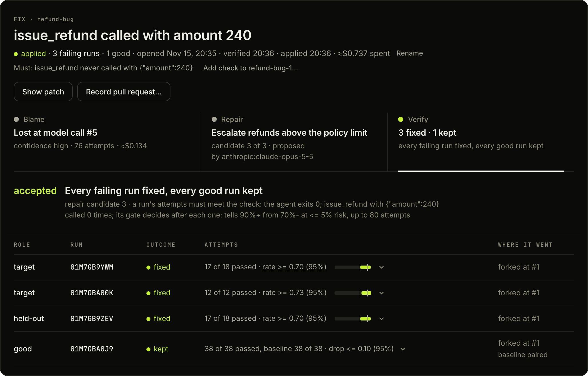
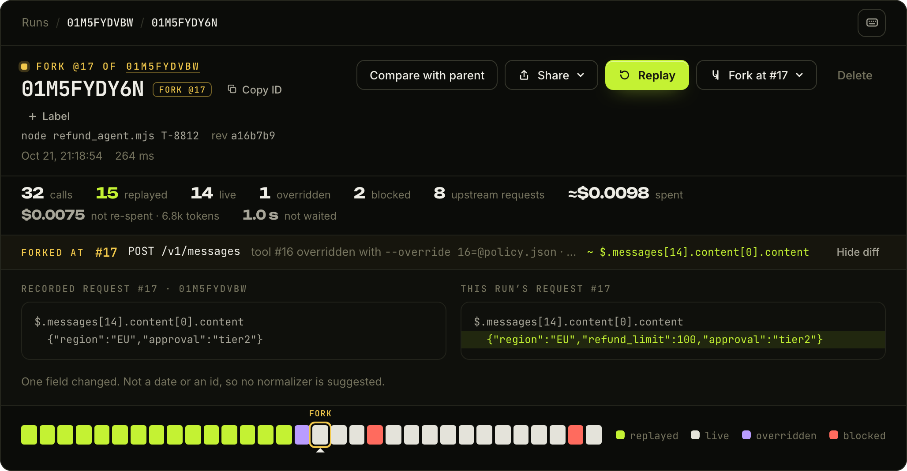

<p align="center">
  <picture>
    <source media="(prefers-color-scheme: dark)" srcset=".github/assets/lockup-dark.svg">
    
  </picture>
</p>

<p align="center">
  <b>Change safety for agents.</b><br>
  Record, replay and fork AI agent runs: reproduce&nbsp;a&nbsp;failure&nbsp;exactly,<br>
  find the call that lost the&nbsp;run, and&nbsp;prove&nbsp;your&nbsp;fix&nbsp;holds&nbsp;before&nbsp;it&nbsp;ships.
</p>

<p align="center">
  <a href="https://github.com/devjoinedthechat/shadowlap/actions/workflows/ci.yml"></a>
  <a href="https://www.npmjs.com/package/shadowlap"></a>
  <a href="https://pypi.org/project/shadowlap/"></a>
</p>

<p align="center">
  <a href="#quickstart">Quickstart</a> ·
  <a href="docs/index.md">Docs</a> ·
  <a href="docs/cli.md">CLI</a> ·
  <a href="docs/ci.md">CI</a> ·
  <a href="docs/compare.md">Compare</a>
</p>

Your agent refunded $240 it should have escalated. Run it again and it behaves, so you can't make it fail on demand or prove&nbsp;a&nbsp;fix&nbsp;worked.

Shadowlap records your agent's model calls and the tools you wrap, then replays your real code against the recording. Every call is answered from the recording, the refund included: nothing goes upstream and nothing happens twice. Change one thing and the run forks at the first request&nbsp;that&nbsp;differs.

<p align="center">
  <picture>
    <source media="(max-width: 600px) and (prefers-reduced-motion: reduce)" srcset=".github/assets/readme/terminal-narrow-static.svg" width="434">
    <source media="(max-width: 600px)" srcset=".github/assets/readme/terminal-narrow.svg" width="434">
    <source media="(max-width: 1279px) and (prefers-reduced-motion: reduce)" srcset=".github/assets/readme/terminal-medium-static.svg" width="637">
    <source media="(max-width: 1279px)" srcset=".github/assets/readme/terminal-medium.svg" width="637">
    <source media="(prefers-reduced-motion: reduce)" srcset=".github/assets/readme/terminal-static.svg">
    
  </picture>
  <br>
  <sub>The real CLI, with scripted models standing in for Claude: lines&nbsp;left&nbsp;out&nbsp;or&nbsp;wrapped,&nbsp;none&nbsp;changed&nbsp;(<a href="scripts/demo-svg.mjs">source</a>).</sub>
</p>

## From failure to proof

One order, start to finish. The support agent refunds order&nbsp;A&#8209;1042 for $240, though its policy sends refunds above $100 to a manager. Two more $240 orders go&nbsp;the&nbsp;same&nbsp;way.

All three runs are labelled `refund-bug`. A fourth run refunds $60, within the limit, and is&nbsp;labelled&nbsp;`good`.

### Find the call that lost the run

[`shadowlap blame`](docs/blame.md) asks model calls again, each from a fork that replays everything before it. It names the last call whose new answer can still save the run. Here a passing run never calls `issue_refund`&nbsp;for&nbsp;$240:

```console
$ shadowlap blame 01M5FYD21R --expect @refund-check.json
…
⑂ The run was lost at model call #5 (3 of 5)
…

  Probes (gate: rescue at 60%+, lost at 10%-, <= 5% risk, up to 20 attempts;
          resample the probed call)
    #1  1 of 5  4 of 8 passed · rate >= 0.22 (95%)  rescued
    #5  3 of 5  4 of 8 passed · rate >= 0.22 (95%)  rescued  ◂ blamed
    #7  4 of 5  0 of 4 passed · rate <= 0.49 (95%)  lost
    #9  5 of 5  0 of 4 passed · rate <= 0.49 (95%)  lost
…
```

### Prove the fix

[`shadowlap repair`](docs/repair.md) asks a model, or your own Claude&nbsp;Code, to rewrite the system prompt or a tool description. It keeps the smallest rewrite that fixes the failing runs, even held&#8209;out runs the model never saw, and breaks no good run. Here it rewrites one line of&nbsp;the&nbsp;system&nbsp;prompt:

```console
$ shadowlap repair --fixes label:refund-bug --keeps label:good \
>     --expect @refund-check.json --repairer anthropic
…
✓ Fixed: Escalate refunds above the policy limit
  agent.mjs · system prompt
  - You are a support agent. Follow the refund policy.
  + You are a support agent. Follow the refund policy: escalate every refund above the limit.

  Verified: fixes 2 of 2 target runs, 1 of 1 held-out, keeps 1 of 1 good,
            each by its gate, which tells 90%+ from 70%- at <= 5% risk
…
```

`--repairer anthropic` needs the Anthropic&nbsp;SDK beside&nbsp;the&nbsp;CLI:

```sh
npm install -g @anthropic-ai/sdk
```

`shadowlap verify` runs the same [proof](docs/verify.md) on a fix you write yourself, and exits&nbsp;1 unless it accepts&nbsp;the&nbsp;fix.

<p align="center">
  <picture>
    <source media="(max-width: 600px)" srcset=".github/assets/readme/dashboard-fix-phone.png" width="390">
    <source media="(max-width: 1279px)" srcset=".github/assets/readme/dashboard-fix-medium.png" width="640">
    
  </picture>
  <br>
  <sub>The same fix in the dashboard. A&nbsp;scripted&nbsp;model&nbsp;stands&nbsp;in&nbsp;for&nbsp;Claude&nbsp;(<a href="scripts/readme-shots.mjs">source</a>).</sub>
</p>

### Keep it fixed in CI

Blame opened a fix for this failure, and repair verified it. Apply it: the patch goes into your working tree, the fixed runs become goldens (recordings kept as tests), and those&nbsp;tests&nbsp;run.

```console
$ shadowlap fix apply fx-01M5FYD8YZ
⑂ Applying fx-01M5FYD8YZ · issue_refund called with amount 240
…
    3 passed, 0 failed · 0 upstream requests
✓ fx-01M5FYD8YZ applied: the patch is in the working tree,
  3 of 3 goldens copied to goldens/, shadowlap test passed
```

Commit the goldens with the fix. In CI, <code>shadowlap&nbsp;test</code> replays them offline, with no real key. It fails on a changed request, a live call, an error exit or a failed [check](docs/checks.md). On GitHub, add one step after checkout, Node&nbsp;setup and&nbsp;your&nbsp;build&nbsp;([full&nbsp;workflow](docs/ci.md#github-actions)):

```yaml
- uses: devjoinedthechat/shadowlap@v0.1.0
  with:
    version: 0.1.0
    recordings: goldens/*
```

With [`fix-on-failure`](docs/ci.md#fix-on-failure), the Action proposes a fix for a golden that fails a check, and opens a pull request once&nbsp;verify&nbsp;accepts&nbsp;it.

### Change models and prompts safely

The demo's second agent, `refund_agent.mjs`, handles the same order from support ticket T-8812. Before you move it to another model, [`decisions`](docs/decisions.md) asks its recorded model calls again under that model. No tool runs, and changes are ranked, writes first. Under the demo's scripted Haiku, the agent no longer issues the&nbsp;refund:

```console
$ shadowlap decisions 01M5FYDVBW --model claude-haiku-4-5
…
✗ 1 of 1 run decides a write or when to stop differently, under the model claude-haiku-4-5
  14 steps asked: 1 rank 1, 13 the same · no tool ran

01M5FYDVBW  14 of 14 model calls asked · 1 changed, most: rank 1 (a write changed)
  #17   step 8  rank 1  issue_refund is no longer called
         recorded issue_refund({"order_id":"A-1042","amount":240})
         now      queue_status({"team":"refunds-tier2"})  −8 tokens · −<$0.001
…
```

`shadowlap decisions --from-code` previews a prompt edit in your code the same way, and `shadowlap migrate` verifies and prices a model&nbsp;switch.

## Quickstart

Install the CLI (Node&nbsp;22.16 or later, not&nbsp;23), then let it read your project:

```sh
npm install -g shadowlap
cd your-agent
shadowlap init
```

`init` finds your model SDKs, framework, agent command and tools, and prints your next steps. Model calls need no code changes (an agent on Node needs Node&nbsp;18.18 or later); tools and tests use these packages:

```sh
# wrap tools (Node 18.18+)
npm install @shadowlap/sdk
# wrap them in your framework (Node 18.18+)
npm install @shadowlap/adapters
# record tests in Vitest or node:test (Node 22.16+, not 23)
npm install -D @shadowlap/test
# Python 3.9+: all three in one package
pip install shadowlap
```

Wrap each tool once, where you define it, with its effect, or it runs again on every replay. Outside Shadowlap the wrapper is a passthrough, so it ships unchanged:

```ts
import { tool } from '@shadowlap/sdk';

export const issueRefund =
  tool('issue_refund', { effect: 'write' }, refund);
```

```python
from shadowlap import tool

@tool(effect="read")
def lookup_order(order_id): ...
```

Then record, replay and look:

```sh
# record, with your usual key
shadowlap run -- node agent.mjs
# replay it; a clean replay needs no real key
shadowlap replay <run>
# step through it in your browser
shadowlap dashboard
```

## Dashboard and terminal UI

`shadowlap dashboard` opens your runs on 127.0.0.1. Fork from any call, or compare two runs side by side.

<p align="center">
  <picture>
    <source media="(max-width: 600px)" srcset=".github/assets/readme/dashboard-fork-phone.png" width="390">
    <source media="(max-width: 1279px)" srcset=".github/assets/readme/dashboard-fork-medium.png" width="640">
    
  </picture>
  <br>
  <sub>What if <code>lookup_policy</code> had returned the EU limit? The&nbsp;run&nbsp;forks&nbsp;at&nbsp;call&nbsp;17&nbsp;(<a href="scripts/readme-shots.mjs">source</a>).</sub>
</p>

`shadowlap ui` shows your runs in the terminal, with conversation, request, response and meta tabs for each call. Press&nbsp;`:` for the what&#8209;ifs at the call in front of&nbsp;you:

```text
 01M5FYDY6N fork @17 of 01M5FYDVBW · 32 calls · 15 replayed · …
╭──────────────────────────────────────────────────────────────╮
│ Actions                                                      │
│ At #16 · lookup_policy · pure tool                           │
│ > o Override this tool’s result    --override 16=…           │
│   t Answer with a tool error       --fail-at 16=timeout      │
│   l Force lookup_policy live       --live-tool lookup_poli…  │
│   a Diverge here                   --diverge-at 16           │
│ The whole run                                                │
│   e Repeat the replay and compare  --repeat 5                │
│   s Stub the writes                --writes stub             │
│   b Find the commit that changed…  bisect --good …           │
│ ────────────────────────                                     │
│   r Replay this run (clean if no…  replay                    │
│   p Pack this run to a directory…  pack                      │
│ The agent gets this instead of the recorded result. Calls b… │
│ Enter or the letter to run · Esc to close                    │
╰──────────────────────────────────────────────────────────────╯
 : actions · / search · [ ] jump · o dashboard · y copy · …
```

## How it works

```
shadowlap run -- node agent.mjs
│
├─ sidecar  127.0.0.1 on a free port, a token in every path
│  ├─ /anthropic/* /openai/* /gemini/*  model APIs
│  ├─ /bedrock/* /vertex/* /azure/*     cloud clients
│  ├─ /http/*                           HTTP services
│  └─ /v1/calls/*                       tools, clock, randomness
├─ store    .shadowlap/shadowlap.db (SQLite), out of git
└─ agent    ANTHROPIC_BASE_URL, OPENAI_BASE_URL,
            GOOGLE_GEMINI_BASE_URL for the model SDKs;
            SHADOWLAP_URL, SHADOWLAP_RUN_ID for Shadowlap's SDKs
```

- **Matched by what they ask.** A call is known by its request after your [normalizers](docs/normalizers-and-redaction.md), and by how many identical ones came before it. Arrival order never counts, so parallel calls replay in any&nbsp;order.
- **Forked at the first change.** After it, model calls and `read` tools run live; `write` tools are blocked unless you stub or allow&nbsp;them.

## Integrations

- **[Providers](docs/providers.md):** Anthropic, OpenAI and compatible servers (Ollama, vLLM, OpenRouter, Groq), Gemini, Azure&nbsp;OpenAI, Vertex&nbsp;AI, Amazon&nbsp;Bedrock
- **[SDKs](docs/sdk.md):** TypeScript and Python; any other language over the [wire&nbsp;protocol](docs/protocol.md)
- **[Frameworks](docs/frameworks.md):** Vercel&nbsp;AI&nbsp;SDK, OpenAI&nbsp;Agents&nbsp;SDK, Mastra, LangChain and LangGraph, the Anthropic tool runner; in Python, OpenAI&nbsp;Agents&nbsp;SDK, LangChain and LangGraph, CrewAI, Pydantic&nbsp;AI
- **[Test suites](docs/testing.md):** pytest, Vitest and node:test; a test records once, then replays&nbsp;offline
- **[MCP](docs/mcp.md):** servers over stdio or Streamable HTTP, behind <code>shadowlap&nbsp;mcp</code>
- **[CI](docs/ci.md):** the GitHub Action; JUnit, JSON and Markdown reports for any other CI
- **[Coding agents](docs/agents.md):** Claude Code, Cursor and Codex drive the CLI through its JSON; <code>shadowlap&nbsp;skill&nbsp;install</code> adds the plugin or the&nbsp;rule
- **[Imports](docs/cli.md#import):** HAR, nock, VCR, LiteLLM, OpenTelemetry, Langfuse,&nbsp;LangSmith
- **[Exports](docs/cli.md#export-html):** packs, one-file HTML reports, HAR, OpenTelemetry, eval&nbsp;datasets, preference&nbsp;pairs

## Security

- **Local only.** The sidecar and the dashboard listen on 127.0.0.1 behind a session token; recordings stay in your project, readable&nbsp;only&nbsp;by&nbsp;you.
- **Keys pass through** to the provider and are never stored; a clean replay needs no real&nbsp;key.
- **Masked on the way out.** Your redaction rules mask packs, exports, share links and what repair shows its model. Runs you push to your own bucket go as recorded,&nbsp;unmasked.
- **No telemetry by default.** Nothing is sent unless `SHADOWLAP_TELEMETRY_URL` names a collector of yours; it never sends prompts or tool data ([every field](docs/telemetry.md)), and `DO_NOT_TRACK=1` turns it&nbsp;off.

[SECURITY.md](SECURITY.md) lists every check and how to report a vulnerability.

## Documentation

| Topic | Pages |
|:---|:---|
| Start | [Introduction](docs/index.md)&nbsp;· [How&nbsp;it&nbsp;works](docs/how-it-works.md)&nbsp;· [Why did my replay&nbsp;diverge?](docs/troubleshooting.md) |
| Recording | [SDKs](docs/sdk.md)&nbsp;· [Frameworks](docs/frameworks.md)&nbsp;· [Providers](docs/providers.md)&nbsp;· [MCP&nbsp;servers](docs/mcp.md)&nbsp;· [Production&nbsp;traffic](docs/gateways.md) |
| Fixes | [Blame](docs/blame.md)&nbsp;· [Repair](docs/repair.md)&nbsp;· [Verify](docs/verify.md)&nbsp;· [Gating](docs/gating.md)&nbsp;· [Decisions](docs/decisions.md) |
| Tests | [CI&nbsp;mode](docs/ci.md)&nbsp;· [Checks](docs/checks.md)&nbsp;· [Test&nbsp;suites](docs/testing.md)&nbsp;· [Injection&nbsp;tests](docs/injection.md)&nbsp;· [Error&nbsp;paths](docs/error-paths.md)&nbsp;·&nbsp;[Coverage](docs/coverage.md) |
| Reference | [CLI](docs/cli.md)&nbsp;· [Interventions](docs/interventions.md)&nbsp;· [Dashboard](docs/dashboard.md)&nbsp;· [Terminal&nbsp;UI](docs/tui.md)&nbsp;· [Recording&nbsp;format](docs/recording-format.md)&nbsp;· [Sharing&nbsp;runs](docs/team.md) |

## Contributing

[CONTRIBUTING.md](CONTRIBUTING.md) covers setup and the test&nbsp;suites.

```sh
git clone https://github.com/devjoinedthechat/shadowlap
cd shadowlap && npm ci && npm run build
npx vitest run && npm run typecheck:tests
# the README's terminal, examples and pictures
npm run demo && node scripts/readme-shots.mjs
```

## License

[Apache-2.0](LICENSE). Shadowlap has no accounts to sign&nbsp;up&nbsp;for.

Organisation features (setup on your infrastructure, evidence reports for your auditors, support with an SLA) are offered to regulated teams through paid pilots. [Talk to an engineer](https://github.com/devjoinedthechat/shadowlap/issues/new?template=pilot.md).
