<p align="center">
  <picture>
    <source media="(prefers-color-scheme: dark)" srcset=".github/assets/lockup-dark.svg">
    
  </picture>
</p>

<p align="center">
  <b>Change safety for agents.</b><br>
  Record, replay and fork AI agent runs: reproduce&nbsp;a&nbsp;failure&nbsp;exactly,<br>
  find the call that lost the&nbsp;run, and&nbsp;prove&nbsp;your&nbsp;fix&nbsp;holds&nbsp;before&nbsp;it&nbsp;ships.
</p>

<p align="center">
  <a href="https://github.com/devjoinedthechat/shadowlap/actions/workflows/ci.yml"></a>
  <a href="https://www.npmjs.com/package/shadowlap"></a>
  <a href="https://pypi.org/project/shadowlap/"></a>
</p>

<p align="center">
  <a href="#quickstart">Quickstart</a> ·
  <a href="docs/index.md">Docs</a> ·
  <a href="docs/cli.md">CLI</a> ·
  <a href="docs/ci.md">CI</a> ·
  <a href="docs/compare.md">Compare</a>
</p>

Your agent refunded $240 it should have escalated. Run it again and it behaves, so you can't make it fail on demand or prove&nbsp;a&nbsp;fix&nbsp;worked.

Shadowlap records your agent's model calls and the tools you wrap, then replays your real code against the recording. Every call is answered from the recording, the refund included: nothing goes upstream and nothing happens twice. Change one thing and the run forks at the first request&nbsp;that&nbsp;differs.

<p align="center">
  <picture>
    <source media="(max-width: 600px) and (prefers-reduced-motion: reduce)" srcset=".github/assets/readme/terminal-narrow-static.svg" width="434">
    <source media="(max-width: 600px)" srcset=".github/assets/readme/terminal-narrow.svg" width="434">
    <source media="(max-width: 1279px) and (prefers-reduced-motion: reduce)" srcset=".github/assets/readme/terminal-medium-static.svg" width="637">
    <source media="(max-width: 1279px)" srcset=".github/assets/readme/terminal-medium.svg" width="637">
    <source media="(prefers-reduced-motion: reduce)" srcset=".github/assets/readme/terminal-static.svg">
    
  </picture>
  <br>
  <sub>The real CLI, with scripted models standing in for Claude: lines&nbsp;left&nbsp;out&nbsp;or&nbsp;wrapped,&nbsp;none&nbsp;changed&nbsp;(<a href="scripts/demo-svg.mjs">source</a>).</sub>
</p>

## Install

Install the CLI. It needs Node 22.16 or later, not&nbsp;23:

```sh
npm install -g shadowlap
```

Model calls need no code changes, though a Node agent needs Node 18.18 or later. Tools and tests use&nbsp;these&nbsp;packages:

```sh
# wrap tools (Node 18.18+)
npm install @shadowlap/sdk
# wrap them in your framework (Node 18.18+)
npm install @shadowlap/adapters
# record tests in Vitest, Jest or node:test (Node 22.16+, not 23)
npm install -D @shadowlap/test
# Python 3.9+: all three in one package
pip install shadowlap
```

## Quickstart

See the whole loop first, with no key and nothing to clone, in about half a&nbsp;minute:

```sh
npx shadowlap demo
```

It records a refund agent breaking its policy, replays it with 0 upstream requests, finds the model call that lost the run, and has a fix proposed, proven and applied, against a scripted model on&nbsp;127.0.0.1.

Then run `init` in your&nbsp;agent's&nbsp;folder:

```sh
cd your-agent
shadowlap init
```

`init` finds your model SDKs, framework, agent command and tools, and prints your next&nbsp;steps.

Wrap each tool where you define it and declare its effect: `read`, `write` or `pure`. Outside Shadowlap the wrapper only calls your function, so wrapped tools&nbsp;ship&nbsp;unchanged:

```ts
import { tool } from '@shadowlap/sdk';

export const issueRefund =
  tool('issue_refund', { effect: 'write' }, refund);
```

```python
from shadowlap import tool

@tool(effect="read")
def lookup_order(order_id): ...
```

A tool you don't wrap runs for real on every replay. `run` names each one the model called. A replay won't run one that writes, or one whose effect nothing declares, until you wrap it, declare its effect under `tools.unrecorded`, or pass&nbsp;`--allow-unrecorded`.

Then record a run, replay it and open&nbsp;the&nbsp;dashboard:

```sh
# record, with your usual key
shadowlap run -- node agent.mjs
# replay it; no real key if clean
shadowlap replay <run>
# step through it in your browser
shadowlap dashboard
```

The [quickstart](docs/quickstart.md) walks through each step with what&nbsp;it&nbsp;prints.

## From failure to proof

The support agent refunds order&nbsp;A&#8209;1042 for $240, though its policy sends refunds above $100 to a manager. Two more $240 orders go&nbsp;the&nbsp;same&nbsp;way.

All three runs are labelled `refund-bug`. A fourth run refunds $60, within the limit, and is&nbsp;labelled&nbsp;`good`.

### Find the call that lost the run

[`shadowlap blame`](docs/blame.md) asks model calls again, each from a fork that replays everything before it. It names the last call whose answer, asked again, can still save the run. Here a passing run never calls `issue_refund`&nbsp;for&nbsp;$240:

```console
$ shadowlap blame 01M64J32D4 --expect @refund-check.json
…
⑂ The run was lost at model call #5 (3 of 5)
…

  Probes (gate: rescue at 60%+, lost at 10%-, <= 5% risk, up to 32 attempts;
          resample the probed call)
    #1  1 of 5  5 of 10 passed · rate >= 0.10 (99.1%)  rescued
    #5  3 of 5  5 of 10 passed · rate >= 0.10 (99.1%)  rescued  ◂ blamed
    #7  4 of 5  0 of 6 passed · rate <= 0.60 (99.1%)   lost
    #9  5 of 5  0 of 6 passed · rate <= 0.60 (99.1%)   lost
…
```

### Prove the fix

[`shadowlap repair`](docs/repair.md) asks a model, or your own Claude&nbsp;Code, to rewrite the system prompt or a tool description. It keeps the smallest rewrite that verify accepts twice, the second time with fresh attempts. Verify accepts one that fixes the failing runs, even held&#8209;out runs the model never saw, and leaves no good run 10&nbsp;points or more worse than before, at 5%&nbsp;risk a&nbsp;run. Here it rewrites one line of&nbsp;the&nbsp;system&nbsp;prompt:

```console
$ shadowlap repair --fixes label:refund-bug --keeps label:good \
>     --expect @refund-check.json --repairer anthropic
…
✓ Fixed: Escalate refunds above the policy limit
  agent.mjs · system prompt
  - You are a support agent. Follow the refund policy.
  + You are a support agent. Follow the refund policy: escalate every refund above the limit.

  Verified: fixes 2 of 2 target runs, 1 of 1 held-out, keeps 1 of 1 good,
            each failing run by its gate, which tells 90%+ from 70%- at <= 5%
            risk, and each good one against its baseline, which tells no drop
            from one of 10+ points at <= 5% risk
…
```

`--repairer anthropic` needs the Anthropic&nbsp;SDK beside&nbsp;the&nbsp;CLI:

```sh
npm install -g @anthropic-ai/sdk
```

`shadowlap verify` runs the same [proof](docs/verify.md) on a fix you write yourself. It exits&nbsp;0 only when it accepts the fix, 1&nbsp;when it rejects it, and 3&nbsp;when it can't&nbsp;decide.

<p align="center">
  <picture>
    <source media="(max-width: 600px)" srcset=".github/assets/readme/dashboard-fix-phone.png" width="390">
    <source media="(max-width: 1279px)" srcset=".github/assets/readme/dashboard-fix-medium.png" width="640">
    <source media="(prefers-reduced-motion: reduce)" srcset=".github/assets/readme/dashboard-fix.png">
    
  </picture>
  <br>
  <sub>The same fix in the dashboard. A&nbsp;scripted&nbsp;model&nbsp;stands&nbsp;in&nbsp;for&nbsp;Claude&nbsp;(<a href="scripts/readme-shots.mjs">source</a>).</sub>
</p>

### Keep it fixed in CI

Blame opened fix `fx-01M64J3BR1` for this failure, and repair verified its patch. Apply it: the patch goes into your working tree, the fixed runs become goldens (recordings kept as tests), and those&nbsp;tests&nbsp;run.

```console
$ shadowlap fix apply fx-01M64J3BR1
⑂ Applying fx-01M64J3BR1 · issue_refund called with amount 240
…
    3 passed, 0 failed · 0 upstream requests
✓ fx-01M64J3BR1 applied: the patch is in the working tree,
  3 of 3 goldens copied to goldens/, shadowlap test passed
```

Commit the goldens with the patch. In CI, <code>shadowlap&nbsp;test</code> replays them offline, with no real key. It fails on a changed request, a live call, an error exit or a failed [check](docs/checks.md). On GitHub, add one step after checkout, Node&nbsp;setup and&nbsp;your&nbsp;build&nbsp;([full&nbsp;workflow](docs/ci.md#github-actions)):

```yaml
- uses: devjoinedthechat/shadowlap@v0.1.0
  with:
    version: 0.1.0
    recordings: goldens/*
```

With [`fix-on-failure`](docs/ci.md#fix-on-failure), the Action proposes a fix for a golden that fails a check, then verifies it on two sets of goldens:

- those that fail the same check, every other one held out from the model that wrote&nbsp;the&nbsp;fix;
- those that pass&nbsp;the&nbsp;check.

It then opens a pull request whose checks start. On a pull request, it keeps one comment with each golden's&nbsp;verdict.

## Model and prompt changes

A second agent, `refund_agent.mjs`, handles the same order from support ticket&nbsp;T&#8209;8812. Before you move it to another model, [<code>shadowlap&nbsp;decisions</code>](docs/decisions.md) sends its recorded model calls to that model and shows which decisions&nbsp;change.

No tool runs. Each step is asked three times under the change and three times as recorded, so a change counts only when it shows beyond the model's own variation. Changes are ranked by what they do, writes first. Under a scripted Haiku, the agent no longer issues&nbsp;the&nbsp;refund:

```console
$ shadowlap decisions 01M64J4EMP --model claude-haiku-4-5
…
✗ 1 of 1 run decides a write or when to stop differently, under the model claude-haiku-4-5
  14 steps asked, 3 samples each and as many as recorded: 1 rank 1, 13 the same · no tool ran

01M64J4EMP  14 of 14 model calls asked · 1 changed, most: rank 1 (a write changed)
  #17   step 8  rank 1  issue_refund is no longer called · in 3 of 3 samples, 0 of 3 as recorded
         recorded issue_refund({"order_id":"A-1042","amount":240})
         now      queue_status({"team":"refunds-tier2"})  −8 tokens · −<$0.001
…
```

`shadowlap decisions --from-code` previews a prompt edit in your code the same way, and <code>shadowlap&nbsp;migrate</code> verifies and prices&nbsp;a&nbsp;model&nbsp;switch.

## What you can do

Each task, with the command or page that does it:

| You want to | Use |
|---|---|
| Reproduce a failing run, with no upstream requests | [`shadowlap replay`](docs/how-it-works.md) |
| See what a run does if one call goes differently | [What-ifs: `--override`, `--inject`, `--fail-at` and more](docs/interventions.md) |
| Find the model call that lost a run | [`shadowlap blame`](docs/blame.md) |
| Get a fix proposed and proven | [`shadowlap repair`](docs/repair.md) |
| Prove a fix you wrote yourself | [`shadowlap verify`](docs/verify.md) |
| Keep runs as tests, replayed offline in CI | [`shadowlap test` and the GitHub Action](docs/ci.md) |
| Say what a passing run must do | [Checks](docs/checks.md) and [judge checks](docs/judges.md) |
| Get verdicts with stated error rates on runs that vary | [Gating](docs/gating.md) |
| See what a prompt edit or a model switch decides differently | [`shadowlap decisions` and `migrate`](docs/decisions.md) |
| Prove which planted instructions a tool call obeyed | [`shadowlap injection`](docs/injection.md) |
| Check the agent's error paths | [`shadowlap test --chaos`](docs/error-paths.md) |
| Find the first commit where a recording fails | [`shadowlap bisect`](docs/cli.md#bisect) |
| Turn a run that went wrong in production into a recording | [Production traffic](docs/gateways.md) |
| Find behaviours no golden covers | [`shadowlap coverage`](docs/coverage.md) |
| Share runs with your team, in a bucket you own | [The team store](docs/team.md) |
| Have a coding agent set Shadowlap up and debug with it | [Coding agents](docs/agents.md) |
| Export preference pairs and tasks for training | [Training](docs/training.md) |

## Dashboard and terminal UI

`shadowlap dashboard` opens your runs on 127.0.0.1:

- **Fork from any call**, or compare two runs side by side. Edit a tool's result, or what a person answered, in the call inspector and fork&nbsp;from&nbsp;it.
- **A failed run opens where it went wrong:** where blame found it lost, or else where it first failed, its calls grouped under the model call each&nbsp;belongs&nbsp;to.
- **A fork's page says what the fork did differently**, ranked as `shadowlap decisions` ranks&nbsp;a&nbsp;change.
- **One press labels a run good or bad**, and `u` undoes it. A fix must leave each good run no worse than its own baseline, as `repair --keeps label:good` holds it, and Runs lists those runs under&nbsp;`label:good`.
- **Large stores and long runs open at once.** Reads of every run or every call, search included, are worked out beside the server, and a long run's calls arrive a page at a time, from&nbsp;any&nbsp;depth.

<p align="center">
  <picture>
    <source media="(max-width: 600px)" srcset=".github/assets/readme/dashboard-fork-phone.png" width="390">
    <source media="(max-width: 1279px)" srcset=".github/assets/readme/dashboard-fork-medium.png" width="640">
    
  </picture>
  <br>
  <sub>What if <code>lookup_policy</code> had returned the EU limit? The&nbsp;run&nbsp;forks&nbsp;at&nbsp;call&nbsp;17&nbsp;(<a href="scripts/readme-shots.mjs">source</a>).</sub>
</p>

`shadowlap ui` shows your runs in the terminal, in the dashboard's colours on a dark or a light background: why a run failed, where blame found it lost and whether its fix held, and what a fork did differently from its parent. Each call has conversation, request, response and meta tabs. Press&nbsp;`:` for the what&#8209;ifs at the selected call, or to blame, repair or verify the&nbsp;run:

<p align="center">
  <picture>
    <source media="(max-width: 600px) and (prefers-reduced-motion: reduce)" srcset=".github/assets/readme/tui-narrow-static.svg" width="520">
    <source media="(max-width: 600px)" srcset=".github/assets/readme/tui-narrow.svg" width="520">
    <source media="(max-width: 1279px) and (prefers-reduced-motion: reduce)" srcset=".github/assets/readme/tui-medium-static.svg" width="637">
    <source media="(max-width: 1279px)" srcset=".github/assets/readme/tui-medium.svg" width="637">
    <source media="(prefers-reduced-motion: reduce)" srcset=".github/assets/readme/tui-static.svg">
    
  </picture>
  <br>
  <sub>The terminal UI on the same project: the failed run, the fork, and the&nbsp;fork&nbsp;menu&nbsp;(<a href="scripts/readme-shots.mjs">source</a>).</sub>
</p>

The [dashboard](docs/dashboard.md) and [terminal UI](docs/tui.md) pages cover every&nbsp;view&nbsp;and&nbsp;key.

## How it works

`shadowlap run` starts a sidecar on 127.0.0.1 and points your agent&nbsp;at&nbsp;it:

```text
shadowlap run -- node agent.mjs
│
├─ sidecar  127.0.0.1 on a free port, a token in every path
│  ├─ /anthropic/* /openai/* /gemini/*  model APIs
│  ├─ /bedrock/* /vertex/* /azure/*     cloud clients
│  ├─ /ai-gateway/*                     Vercel's AI Gateway
│  ├─ /http/*                           HTTP services
│  └─ /v1/calls/*                       tools, clock, randomness
├─ store    .shadowlap/shadowlap.db (SQLite), out of git
└─ agent    ANTHROPIC_BASE_URL, OPENAI_BASE_URL,
            GOOGLE_GEMINI_BASE_URL for the model SDKs;
            SHADOWLAP_URL, SHADOWLAP_RUN_ID for Shadowlap's SDKs
```

- **Matched by request, not order.** A call is identified by its request and by how many identical requests came before it, after your [normalizers](docs/normalizers-and-redaction.md) mask values such as&nbsp;ids. Parallel calls match in whatever order&nbsp;they&nbsp;arrive.
- **Forked at the first change.** After it, model calls and `read` tools run live; `write` tools are blocked or stubbed unless you&nbsp;allow&nbsp;them.

[How it works](docs/how-it-works.md) covers fingerprints, matching, effects and&nbsp;the&nbsp;network&nbsp;guard.

## Integrations

What Shadowlap records, runs in and exchanges with:

| Area | Works with |
|:---|:---|
| [Providers](docs/providers.md) | Anthropic, OpenAI, Gemini, Azure OpenAI, Claude on Microsoft Foundry, Gemini Enterprise Agent Platform (Vertex AI) and Amazon Bedrock (OpenAI's SDK on it too) |
| [Gateways and compatible servers](docs/providers.md) | Vercel's AI Gateway; OpenAI&#8209;compatible servers (Ollama, vLLM, OpenRouter, Groq); any gateway or host that speaks one of their formats, declared in the config |
| [SDKs](docs/sdk.md) | TypeScript and Python; any other language over the [wire protocol](docs/protocol.md) |
| [Frameworks (TypeScript)](docs/frameworks.md) | Mastra, Vercel AI SDK, OpenAI Agents SDK, LangChain, LangGraph, Anthropic tool runner, Claude Agent SDK |
| [Frameworks (Python)](docs/frameworks.md) | CrewAI, OpenAI Agents SDK, LangChain, LangGraph, Pydantic AI, Google ADK, LlamaIndex, Microsoft Agent Framework, Strands, smolagents, Agno, Claude Agent SDK |
| [Test suites](docs/testing.md) | pytest, Vitest, Jest and node:test; a test records once, then replays offline |
| [MCP](docs/mcp.md) | Servers over stdio or Streamable HTTP, recorded through the `shadowlap mcp` proxy, which your client reaches over stdio or, with `--listen`, over HTTP |
| [CI](docs/ci.md) | The GitHub Action; JUnit, JSON and Markdown reports for any other CI |
| [Coding agents](docs/agents.md) | Claude Code, Codex, Cursor and Copilot drive the CLI through its JSON output; `skill install` adds skills that set Shadowlap up and check every change |
| [Imports](docs/cli.md#import) | HAR, nock, VCR, LiteLLM, OpenTelemetry, Langfuse, LangSmith, Arize Phoenix, Logfire; every trace of a window at once from Langfuse, Phoenix and Logfire (`--since 7d`) |
| [Exports](docs/cli.md#export-html) | Packs (a run as a folder), one&#8209;file HTML reports, HAR, OpenTelemetry, eval datasets and preference pairs |

## Documentation

The [docs](docs/index.md) start from the introduction. By topic:

- **Start:** [Introduction](docs/index.md) · [Quickstart](docs/quickstart.md) · [How it works](docs/how-it-works.md) · [Why replays diverge](docs/troubleshooting.md)
- **Recording:** [SDKs](docs/sdk.md) · [Frameworks](docs/frameworks.md) · [Providers](docs/providers.md) · [MCP servers](docs/mcp.md) · [Production traffic](docs/gateways.md)
- **Fixes:** [Blame](docs/blame.md) · [Repair](docs/repair.md) · [Verify](docs/verify.md) · [Gating](docs/gating.md) · [Decisions](docs/decisions.md)
- **Tests:** [CI mode](docs/ci.md) · [Test suites](docs/testing.md) · [Injection tests](docs/injection.md) · [Checks](docs/checks.md) · [Error paths](docs/error-paths.md) · [Coverage](docs/coverage.md)
- **Reference:** [CLI](docs/cli.md) · [Recording format](docs/recording-format.md) · [Interventions](docs/interventions.md) · [Dashboard](docs/dashboard.md) · [Terminal UI](docs/tui.md) · [Sharing runs](docs/team.md)

## Contributing

[CONTRIBUTING.md](CONTRIBUTING.md) covers setup, the test suites, lint, commit messages and how a pull request&nbsp;is&nbsp;reviewed.

```sh
git clone https://github.com/devjoinedthechat/shadowlap
cd shadowlap && npm ci && npm run build
npx vitest run && npm run typecheck:tests
# regenerate the README's terminal, examples and pictures
npm run demo && node scripts/readme-shots.mjs
```

## Security

- **Local only.** The sidecar and the dashboard listen on 127.0.0.1 behind a session token; recordings stay in your project, readable&nbsp;only&nbsp;by&nbsp;you.
- **Keys never stored.** The API keys your calls send pass through to the provider and are never written; a clean replay needs no&nbsp;real&nbsp;key.
- **Masked on the way out.** Your redaction rules mask packs, exports, share links and what repair shows its model. Runs you push to your own bucket go as recorded, with no&nbsp;rule&nbsp;applied.
- **Credentials masked in every copy.** Every copy of a run masks each credential whose shape Shadowlap&nbsp;knows.
- **No telemetry by default.** Nothing is sent unless `SHADOWLAP_TELEMETRY_URL` names a collector you run, and [what&nbsp;is&nbsp;sent](docs/telemetry.md) never includes prompts or tool&nbsp;data. `DO_NOT_TRACK=1` opts&nbsp;out.

[SECURITY.md](SECURITY.md) lists every safeguard and how to report&nbsp;a&nbsp;vulnerability.

## License

[Apache-2.0](LICENSE). Shadowlap has no accounts to sign&nbsp;up&nbsp;for.
